<div align="center">

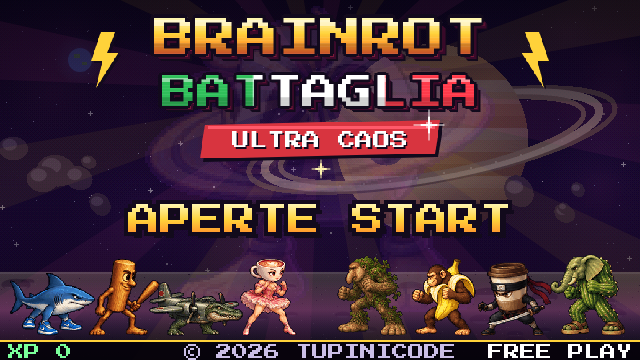

# 🦈 BRAINROT BATTAGLIA · *ULTRA CAOS* 🥊

**O jogo de luta 2D estilo *Street Fighter II* estrelado pelos memes do Italian brainrot.**<br>
Tralalero, Tung Tung Sahur, Bombardiro e companhia contra uma vaca cósmica que quer controlar todos os memes do mundo.

[](https://nextjs.org)
[](https://react.dev)
[](https://www.typescriptlang.org)
[](https://developer.mozilla.org/docs/Web/API/Canvas_API)
[](https://developer.mozilla.org/docs/Web/API/Web_Audio_API)

<a href="#-como-jogar"><b>🎮 Jogar</b></a> ·
<a href="#-abertura-tupinicode"><b>🌴 Abertura</b></a> ·
<a href="#-o-elenco"><b>🧬 Elenco</b></a> ·
<a href="#-recursos"><b>✨ Recursos</b></a> ·
<a href="#-desenvolvimento"><b>🛠️ Desenvolvimento</b></a> ·
<a href="docs/README.md"><b>📚 Documentação</b></a>

</div>

---

## 🌴 Abertura Tupinicode

Uma abertura no estilo dos arcades dos anos 90: o CRT na selva carrega o jogo de verdade (com barra de progresso), o logo cai com glitch e jingle de boot, e o crédito do desenvolvedor aparece antes da tela de aviso e do título.

<div align="center">
<table>
  <tr>
    <td>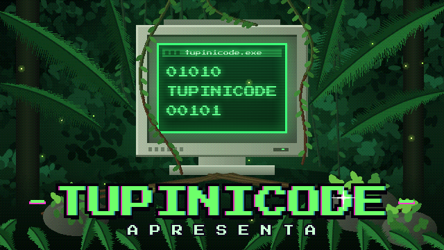</td>
    <td>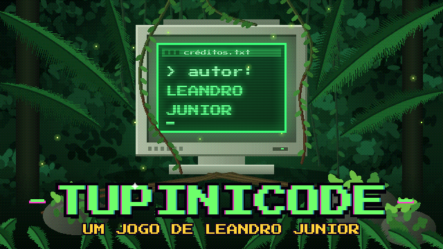</td>
  </tr>
  <tr>
    <td align="center"><sub><b>TUPINICODE</b> apresenta</sub></td>
    <td align="center"><sub>Um jogo de <b>Leandro Junior</b></sub></td>
  </tr>
  <tr>
    <td>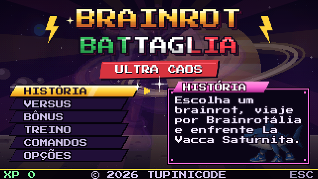</td>
    <td>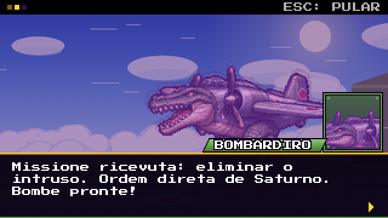</td>
  </tr>
  <tr>
    <td align="center"><sub><b>Menu</b> com placas inclinadas estilo Neo-Geo</sub></td>
    <td align="center"><sub><b>Cutscenes</b> com barras de cinema e retrato de quem fala</sub></td>
  </tr>
</table>
</div>

## 📖 A história

> *Muito além da internet existe **Brainrotália**: a terra paralela onde moram os memes mais absurdos já criados.*

Durante séculos, bastava um *tralalá*, um *tung tung*, um *bananini*… e o mundo sorria. Até que **La Vacca Saturno Saturnita** surgiu nos anéis de Saturno com **O ALGORITMO**, um sinal que hipnotiza qualquer meme. Os olhos ficaram roxos. As vozes, ocas.

**Apenas um coração resistiu.** Atravesse Brainrotália, liberte sete rivais hipnotizados, recupere os **7 fragmentos** do sinal e enfrente a vaca cósmica no fim do universo.

<div align="center">
<table>
  <tr>
    <td>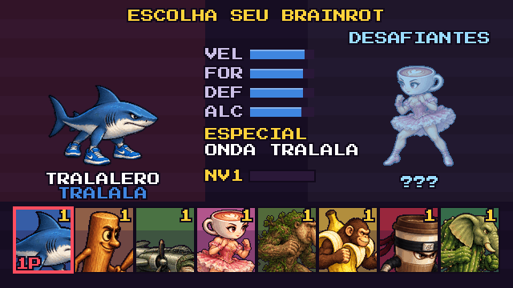</td>
    <td>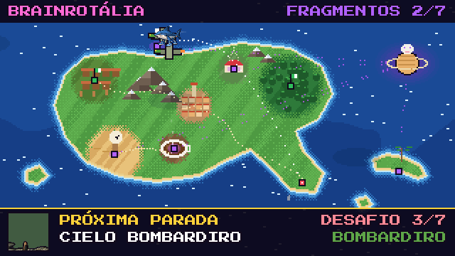</td>
  </tr>
  <tr>
    <td align="center"><sub><b>Escolha seu brainrot</b> e liberte os outros sete</sub></td>
    <td align="center"><sub><b>Mapa de Brainrotália</b> entre uma luta e outra</sub></td>
  </tr>
</table>
</div>

## 🧬 O elenco

<div align="center">
<table>
  <tr>
    <td align="center" width="33%">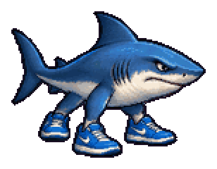<br><b>Tralalero Tralala</b><br><sub>🌊 ONDA TRALALA · rápido e equilibrado</sub></td>
    <td align="center" width="33%">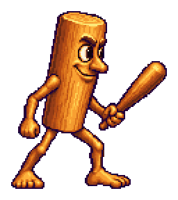<br><b>Tung Tung Tung Sahur</b><br><sub>🪵 TACO SAHUR · alcance e força</sub></td>
    <td align="center" width="33%">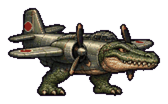<br><b>Bombardiro Crocodilo</b><br><sub>💣 BOMBA · controla o espaço</sub></td>
  </tr>
  <tr>
    <td align="center">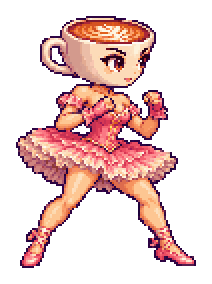<br><b>Ballerina Cappuccina</b><br><sub>🩰 PIRUETA · a mais veloz</sub></td>
    <td align="center">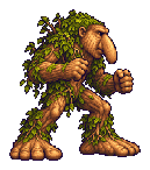<br><b>Brr Brr Patapim</b><br><sub>🌳 TERREMOTO · golpe baixo</sub></td>
    <td align="center">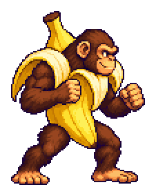<br><b>Chimpanzini Bananini</b><br><sub>🍌 BANANARANGUE · vai e volta</sub></td>
  </tr>
  <tr>
    <td align="center">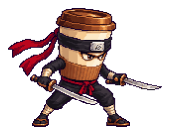<br><b>Cappuccino Assassino</b><br><sub>☕ TELEPORTE · surge pelas costas</sub></td>
    <td align="center">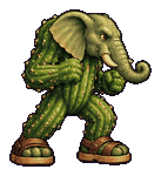<br><b>Lirilì Larilà</b><br><sub>⏰ RELÓGIO · congela o tempo</sub></td>
    <td align="center">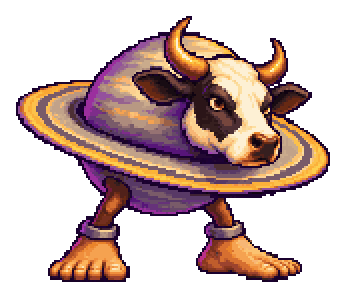<br><b>👑 La Vacca Saturnita</b><br><sub>🪐 ANEL CÓSMICO · chefe final</sub></td>
  </tr>
</table>
</div>

<details>
<summary><b>📊 Atributos de cada lutador</b></summary>

| Lutador | VEL | FOR | DEF | ALC | Casa |
|---------|:---:|:---:|:---:|:---:|------|
| Tralalero | 1,7 | 1,0 | 1,0 | 1,0 | Spiaggia |
| Tung Sahur | 1,5 | 1,15 | 0,95 | 1,25 | Villaggio |
| Bombardiro | 1,3 | 1,2 | 1,1 | 1,1 | Cielo |
| Ballerina | 2,0 | 0,85 | 0,9 | 1,0 | Teatro |
| Patapim | 1,4 | 1,1 | 1,05 | 1,15 | Giungla |
| Chimpanzini | 1,9 | 0,9 | 0,95 | 0,9 | Piantagione |
| Assassino | 1,9 | 1,0 | 0,9 | 1,15 | Caffè |
| Lirilì | 1,2 | 1,2 | 1,2 | 1,1 | Deserto |
| **Saturnita** | 1,35 | 1,3 | 1,45 | 1,3 | Saturno |

Fichas completas, falas e rivalidades em [docs/jogo/05-personagens.md](docs/jogo/05-personagens.md).
</details>

## ✨ Recursos

<table>
  <tr>
    <td width="50%" valign="top">

### 🥊 Combate de arcade
- Correntes, **cancelamento em especial**, uppercut com comando **→ ↓ ↘**, agarrão
- **EX** (meia barra) e **Super** com tela de corte
- Juggle, escalonamento de dano, hit-stop e tremor de tela
- **Hitboxes medidas dos pixels** dos próprios sprites (aperte `Tab` para ver)
- IA em 3 níveis que defende alto/baixo, faz anti-aéreo e gasta barra

  </td>
  <td width="50%" valign="top">

### 📜 Modo história completo
- Prólogo do mundo + prólogo e final **próprios de cada lutador**
- Cena antes e depois de **cada rival**, com rivalidades especiais
- Mapa animado de **Brainrotália** entre as lutas
- Intro e derrota do chefe, epílogo e créditos
- Narração por síntese de voz em 🇧🇷 🇮🇹 🇬🇧

  </td>
  </tr>
  <tr>
    <td valign="top">

### 🎵 Tudo gerado ao vivo
- **21 músicas** de um sintetizador FM de 2 operadores (família YM2151)
- 25 efeitos sonoros, reverb e delay, **zero arquivos de áudio**
- **13 cenários pintados em código** e quantizados em pixel art com dithering Bayer

  </td>
  <td valign="top">

### 🚗 Fases bônus e progressão
- Destrua a **Macchina del Nonno**, o **Cybercaminhão** de "vidro blindado" e o **Bi-ai-di** (com papagaio do milk shake 🦜)
- **XP e níveis 1–10** por personagem, salvos no navegador
- Versus local, Treino com leitura de dano e controles de **toque** no celular

  </td>
  </tr>
</table>

<div align="center">
<table>
  <tr>
    <td>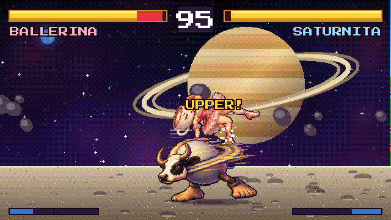</td>
    <td></td>
  </tr>
  <tr>
    <td align="center"><sub><b>Luta contra o chefe</b> nos anéis de Saturno</sub></td>
    <td align="center"><sub><b>Fase bônus</b>: "MILK SHAKE DE MORANGO… É MUITO CREMOSO!"</sub></td>
  </tr>
</table>

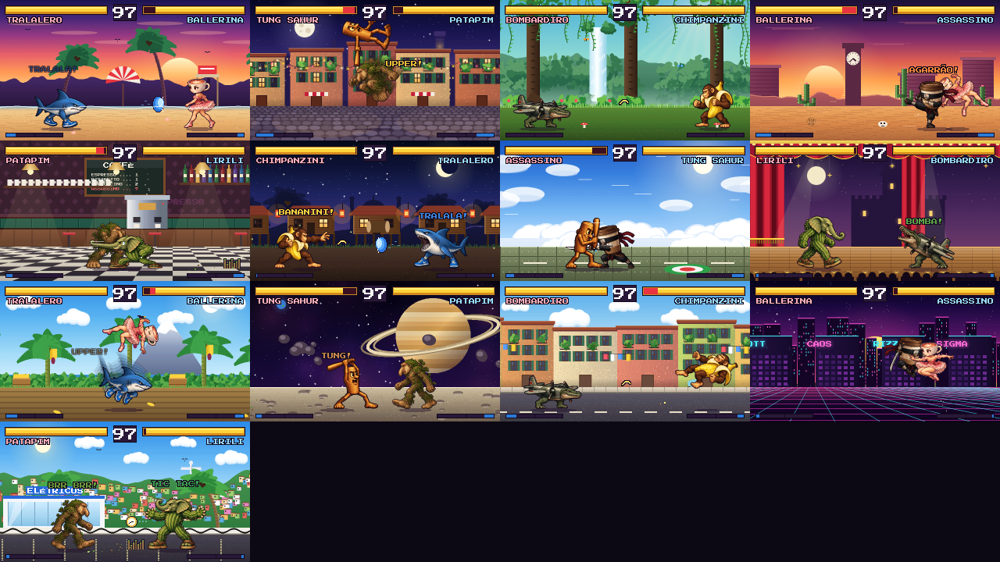
<sub>Os 13 cenários, cada um com música e animações próprias</sub>
</div>

## 🎮 Como jogar

```bash
npm install
npm run dev        # http://localhost:3000
```

Aperte **Enter** (ou toque na tela) para começar: o navegador só libera o som depois da primeira interação. Escolha **HISTÓRIA** para a campanha ou **TREINO** para praticar combos.

| | Jogador 1 | Jogador 2 (versus) |
|---|:---:|:---:|
| **Mover / pular / agachar** | `A` `D` `W` `S` | `←` `→` `↑` `↓` |
| **Soco · Chute · Especial** | `J` · `K` · `L` | `B` · `N` · `M` |
| **Start / pausa** | `Enter` | |
| **Voltar / pular cutscene** | `Esc` | |
| **Ver hitboxes** | `Tab` | |

<details>
<summary><b>🕹️ Lista de comandos</b></summary>

| Golpe | Comando |
|-------|---------|
| Soco forte (alto) | `→` + Soco |
| Rasteira (baixo) | `↓` + Chute |
| Uppercut (lança para juggle) | `→` `↓` `↘` + Soco |
| Agarrão | Perto + `→` + Chute |
| Especial EX (½ barra) | `↓` `↘` `→` + Especial |
| Super (barra cheia) | Especial |
| Corrente | Soco → soco / chute / forte · acerto → especial cancela |
| Defesa | Segure para trás (agachado contra golpes baixos) |

Mais detalhes em [docs/jogo/03-controles-e-comandos.md](docs/jogo/03-controles-e-comandos.md) e [docs/jogo/04-sistema-de-combate.md](docs/jogo/04-sistema-de-combate.md).
</details>

## 🛠️ Desenvolvimento

> Requer **Node.js 20.9+**. O pipeline de sprites (opcional) usa Python com `pillow`, `numpy` e `scipy`.

| Comando | O que faz |
|---------|-----------|
| `npm run dev` | Servidor de desenvolvimento (Turbopack) |
| `npm run build` · `npm start` | Build de produção (página estática) e servidor |
| `npm run lint` · `npm run typecheck` | ESLint e TypeScript |
| `npm run format` | Prettier |
| `npm test` | Campanha completa, 24 lutas CPU × CPU, textos e snapshots visuais, tudo headless |
| `npm run test:snapshot:update` | Aceita uma mudança visual intencional |
| `npm run readme:art` | Regera as imagens deste README com o próprio motor |
| `npm run sprites` | Folhas de sprite → atlas em `public/atlases/` |

### 🧱 Arquitetura

```
src/
├── app/                 Next.js App Router: layout, página, fonte, ícones
├── components/game/     Casca React: gabinete, barra de botões, toque, legenda
└── game/                Motor do jogo em módulos ES (sem React)
    ├── core/            canvas, entrada, cenas e loop de 60 Hz
    ├── audio/           sintetizador FM, 21 músicas, narrador, locutor
    ├── sprites/         atlas HD, cache, hitboxes medidas dos pixels
    ├── characters/      um arquivo por lutador + carros
    ├── combat/          Fighter, Fight, IA, especiais, Treino, Bônus
    ├── story/           textos da campanha e montagem das cutscenes
    ├── stages/          kit de pintura + um arquivo por cenário
    ├── scenes/          todas as telas e o fluxo da história
    └── index.js         createGame(): a API que a página usa
```

A página e o motor conversam por uma API pequena e tipada (`createGame`, `setMusic`, `setNarrator`, `pressButton`, `on('voice')`). O motor é carregado só no cliente, com `import()` dinâmico. Veja [docs/tecnico/01-arquitetura.md](docs/tecnico/01-arquitetura.md).

<details>
<summary><b>🔬 Como a migração para Next.js foi validada</b></summary>

O jogo nasceu como um único `index.html` de 2,7 MB (guardado em [`legacy/`](legacy/index.html)). A migração recortou o código em módulos **sem reescrever a lógica** e foi comparada com a versão original usando a mesma semente aleatória:

- perfis de colisão dos 9 personagens: **idênticos**;
- hash de 3.672 sprites (9 personagens × 17 poses × 8 quadros × 3 fases): **idêntico**;
- 13 lutas CPU × CPU (uma por cenário, 900 quadros): **mesmos quadros e mesma vida no fim**.

Essa rede de segurança continua no projeto como `tests/visual-snapshot.js`.
</details>

## 📚 Documentação

<table>
  <tr>
    <td valign="top" width="50%">

**🎮 O jogo**
1. [Visão geral](docs/jogo/01-visao-geral.md)
2. [Modos e telas](docs/jogo/02-modos-e-telas.md)
3. [Controles e comandos](docs/jogo/03-controles-e-comandos.md)
4. [Sistema de combate](docs/jogo/04-sistema-de-combate.md)
5. [Personagens](docs/jogo/05-personagens.md)
6. [História e cutscenes](docs/jogo/06-historia.md)
7. [Mapa de Brainrotália](docs/jogo/07-mapa-brainrotalia.md)
8. [Cenários](docs/jogo/08-cenarios.md)
9. [Fases bônus e memes](docs/jogo/09-fases-bonus-e-memes.md)
10. [Progressão e dificuldade](docs/jogo/10-progressao-e-dificuldade.md)

  </td>
  <td valign="top" width="50%">

**🛠️ Técnico**
1. [Arquitetura](docs/tecnico/01-arquitetura.md)
2. [Motor: loop, cenas e entrada](docs/tecnico/02-motor-e-loop.md)
3. [Renderização e sprites](docs/tecnico/03-renderizacao-e-sprites.md)
4. [Pintura dos cenários](docs/tecnico/04-pintura-de-cenarios.md)
5. [Áudio e narração](docs/tecnico/05-audio-e-narracao.md)
6. [Ferramentas e testes](docs/tecnico/06-ferramentas-e-testes.md)
7. [Guia de extensão](docs/tecnico/07-guia-de-extensao.md)
8. [Roadmap](docs/tecnico/08-roadmap.md)

  </td>
  </tr>
</table>

## 🙌 Créditos

- **Conceito, sprite sheets e direção:** Leandro Junior.
- **Código, músicas, cenários e roteiro:** feitos com Claude.
- **Fonte:** [Press Start 2P](https://fonts.google.com/specimen/Press+Start+2P), de CodeMan38 (SIL Open Font License).
- Os nomes dos personagens vêm da trend **"Italian brainrot"**. Toda a arte e a música deste projeto são originais.

<div align="center">
<br>
<sub><b>TRALALERO TRALALÀ!</b> · feito no Brasil com 🇮🇹 no coração</sub>
</div>
