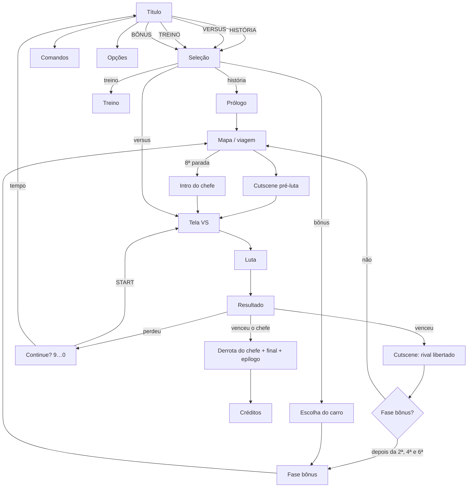

# 02 · Modos de jogo e fluxo de telas

## Menu principal

| Item | Modo (`S.mode`) | O que faz |
|------|-----------------|-----------|
| **HISTÓRIA** | `arcade` | Campanha completa: prólogo, 7 lutas em ordem aleatória com viagens pelo mapa, 3 fases bônus, chefe final e final próprio do personagem. |
| **VERSUS** | `versus` | Dois jogadores no mesmo teclado, cenário sorteado (entre os 10 de luta). Os dois ganham XP. |
| **BÔNUS** | `bonus` | Escolha um lutador e um carro e destrua-o para farmar XP. Dá para repetir quantas vezes quiser. |
| **TREINO** | `training` | Boneco parado, vida infinita, sem cronômetro, barra que recarrega sozinha e leitura do dano do combo. **Tab** mostra as hitboxes. |
| **COMANDOS** | – | Lista de golpes em duas páginas (← → troca de página). |
| **OPÇÕES** | – | Dificuldade, volume da música, narrador ligado/desligado, escolha da voz de cada papel e teste das vozes. |

## Fluxo de telas

## Telas

| Tela | Detalhes |
|------|----------|
| **Título** | O logo cai com um "slam" e um flash. Ao fundo, a Piazza à noite com a câmera passeando, raios girando e um lutador diferente aparecendo a cada 4 s ao lado da descrição do item do menu. Mostra o XP total. |
| **Seleção** | Grade com os 8 lutadores e o nível de cada um. No modo solo, mostra as barras VEL/FOR/DEF/ALC, o especial e a barra de XP. No versus, 1P e 2P escolhem ao mesmo tempo (com cores alternativas no espelho). |
| **VS** | Os dois lutadores entram deslizando em 2×, o "VS" pulsa e o locutor anuncia "*Tralalero Tralalà… contro… Tung tung tung Sahur!*". Enquanto isso o jogo pré-renderiza as poses dos dois. |
| **Luta** | HUD estilo SF2: barras de vida com dano atrasado em vermelho, cronômetro de 99, marcadores de rounds, barra de especial com marcas de EX e MAX, contador de hits. **Enter** pausa. |
| **Resultado** | Pose de vitória em 2×, frase de vitória com efeito de máquina de escrever, XP ganho e "LEVEL UP!". |
| **Continue** | Contagem de 9 a 0 (um número por segundo). START refaz a mesma luta; quando o tempo acaba, aparece "FIM DE JOGO". |
| **Final** | O campeão num pódio, os outros sete comemorando, fogos de artifício e créditos em rotação. |

## Pausa

Durante a luta, **Enter** (ou **Esc**, ou START no toque) abre a pausa com **CONTINUAR** e **SAIR PARA O MENU**.
