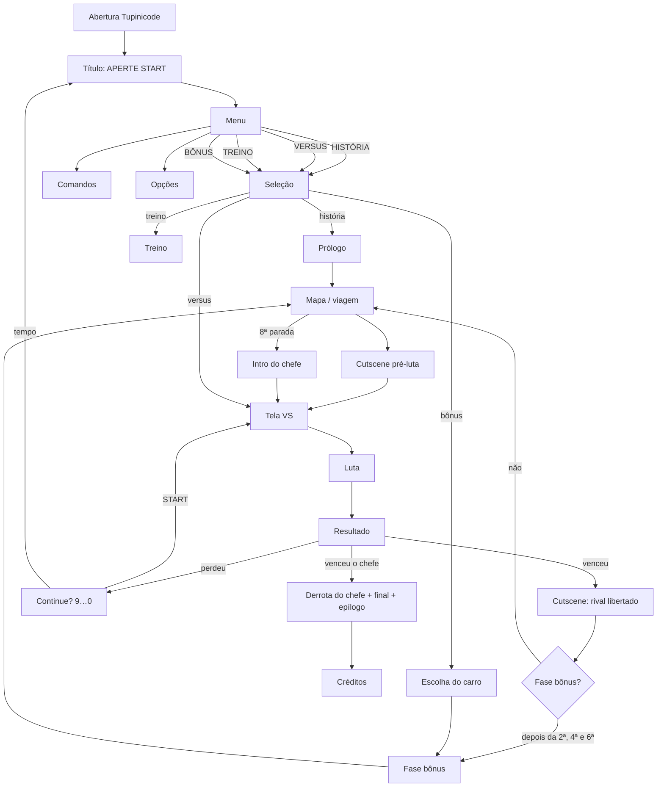

# 02 · Modos de jogo e fluxo de telas

## Abertura

Código: [`src/game/scenes/intro.js`](../../src/game/scenes/intro.js) e a arte em [`src/game/ui/tupinicode.js`](../../src/game/ui/tupinicode.js).

Uma abertura no estilo dos arcades dos anos 90 (era Neo-Geo), com a identidade da **Tupinicode**: uma selva à noite com um computador CRT antigo coberto de cipós, vaga-lumes e o logo com franja cromática magenta/ciano.

| Fase | O que acontece |
|------|----------------|
| **Carregamento** | O CRT liga (linha que abre na horizontal e depois na vertical) e mostra `tupinicode.exe` com uma barra de progresso **real**: atlas dos personagens e os 13 cenários, pintados um por quadro para a animação não travar. |
| **PRONTO / APERTE START** | O navegador só libera som depois de uma interação; por isso a abertura espera o START (Enter ou toque) antes do jingle. Se o som já estiver liberado, segue sozinha. |
| **Logo** | O monitor digita `10101 / TUPINICODE / 01010`, o logo grande cai com flash, tremor, glitch e o jingle de boot, e o locutor diz "*Tupinicode… presents!*". Aparece "A P R E S E N T A". |
| **Crédito** | O monitor abre `créditos.txt` e digita "> autor: LEANDRO JUNIOR"; embaixo, "UM JOGO DE LEANDRO JUNIOR". |
| **AVISO** | Homenagem às telas de aviso dos arcades, com uma piada no lugar do texto legal ("Este jogo contém níveis PERIGOSOS de brainrot…"). |

**Enter** pula para a próxima fase e **Esc** pula a abertura inteira.

## Menu principal

| Item | Modo (`S.mode`) | O que faz |
|------|-----------------|-----------|
| **HISTÓRIA** | `arcade` | Campanha completa: prólogo, 7 lutas em ordem aleatória com viagens pelo mapa, 3 fases bônus, chefe final e final próprio do personagem. |
| **VERSUS** | `versus` | Dois jogadores no mesmo teclado, cenário sorteado (entre os 10 de luta). Os dois ganham XP. |
| **BÔNUS** | `bonus` | Escolha um lutador e um carro e destrua-o para farmar XP. Dá para repetir quantas vezes quiser. |
| **TREINO** | `training` | Boneco parado, vida infinita, sem cronômetro, barra que recarrega sozinha e leitura do dano do combo. **Tab** mostra as hitboxes. |
| **COMANDOS** | – | Lista de golpes em duas páginas (← → troca de página). |
| **OPÇÕES** | – | Dificuldade, volume da música, narrador ligado/desligado, escolha da voz de cada papel e teste das vozes. |

## Fluxo de telas

## Telas

| Tela | Detalhes |
|------|----------|
| **Título** | O logo cai com um "slam" e um flash, com estrelinhas brilhando nas letras. Ao fundo, os anéis de Saturno, raios girando e La Vacca Saturnita gigante e translúcida. O elenco sobe um a um na base da tela. **APERTE START** pisca e a faixa de baixo mostra o XP total, "© 2026 TUPINICODE" e "FREE PLAY". |
| **Menu** | Depois do START, o elenco desce e entram as placas inclinadas dos modos (a escolhida fica dourada, maior e com brilho correndo) e o cartão do modo, com a descrição e um lutador ao fundo. **Esc** volta para a tela de START. |
| **Seleção** | Grade com os 8 lutadores e o nível de cada um. No modo solo, mostra as barras VEL/FOR/DEF/ALC, o especial e a barra de XP. No versus, 1P e 2P escolhem ao mesmo tempo (com cores alternativas no espelho). |
| **VS** | Os dois lutadores entram deslizando em 2×, o "VS" pulsa e o locutor anuncia "*Tralalero Tralalà… contro… Tung tung tung Sahur!*". Enquanto isso o jogo pré-renderiza as poses dos dois. |
| **Luta** | HUD estilo SF2: barras de vida com dano atrasado em vermelho, cronômetro de 99, marcadores de rounds, barra de especial com marcas de EX e MAX, contador de hits. **Enter** pausa. |
| **Resultado** | Pose de vitória em 2×, frase de vitória com efeito de máquina de escrever, XP ganho e "LEVEL UP!". |
| **Continue** | Contagem de 9 a 0 (um número por segundo). START refaz a mesma luta; quando o tempo acaba, aparece "FIM DE JOGO". |
| **Final** | O campeão num pódio, os outros sete comemorando, fogos de artifício e créditos em rotação. |

## Pausa

Durante a luta, **Enter** (ou **Esc**, ou START no toque) abre a pausa com **CONTINUAR** e **SAIR PARA O MENU**.
