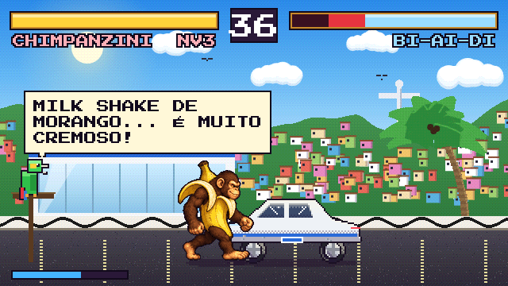

# 09 · Fases bônus e memes

A fase de quebrar o carro é uma homenagem à fase bônus de *Street Fighter II*. No código é a classe `Bonus`, que herda de `Fight`: o segundo "lutador" é um carro parado com estados de dano, e o XP é pago no final.

Código: [`src/game/combat/bonus.js`](../../src/game/combat/bonus.js), [`src/game/combat/car.js`](../../src/game/combat/car.js) e os desenhos em [`src/game/characters/cars.js`](../../src/game/characters/cars.js).

## Os carros

| Tipo | Carro | Vida | Defesa | Tempo | Cenário | Música |
|------|-------|------|--------|-------|---------|--------|
| `nonno` | La Macchina del Nonno (clássico vermelho) | 340 | 1,7 | 45 s | Strada del Nonno | `bonus` |
| `cyber` | Cybercaminhão (cunha de aço inox) | 430 | 2,6 | 55 s | Neon Città | `cyber` |
| `byd` | O Bi-ai-di (elétrico branco) | 340 | 1,9 | 45 s | Vila Brasilini | `byd` |

- **Estados de dano:** 0 a 3 conforme a vida que sobra (75%, 50%, 25%) e 4 quando destruído. Cada estado acrescenta amassados, vidros trincados ou escurecidos, uma porta ou roda perdida e fumaça.
- **Na história:** as fases bônus vêm depois da 2ª (Nonno), da 4ª (Cyber) e da 6ª luta (Bi-ai-di).
- **No modo BÔNUS:** você escolhe o carro na tela "ESCOLHA O ALVO" e pode repetir quantas vezes quiser.

## XP

| Resultado | XP |
|-----------|----|
| Carro destruído | `300 + segundos restantes × 10` (+150 no Cybercaminhão) |
| Tempo esgotado | Até 240, proporcional ao dano causado |

## Eventos de meme

| Carro | Quando | Balão / voz |
|-------|--------|-------------|
| Nonno | Destruído | "MAMMA MIA! LA MIA MACCHINA!" (voz italiana) |
| Cyber | 1º, 2º e 3º estado de dano | "OPS..." → "...BEM, PELO MENOS NÃO ATRAVESSOU." → "VIDRO BLINDADO, ELES DISSERAM..." (som de vidro trincando) |
| Cyber | Destruído | "É... TEM ESPAÇO PRA MELHORAR." |
| Bi-ai-di | A cada estado de dano | "NÓOOO! MEU BI-AI-DI!" |
| Bi-ai-di | Destruído | "NÃÃÃO... ERA ZERO KM!" |
| Bi-ai-di | A cada ~8,7 s | Um **papagaio** num poleiro no canto grasna e diz "MILK SHAKE DE MORANGO... É MUITO CREMOSO!" (voz aguda, bico animado) |

## Referências

- **Cybertruck:** no lançamento de 2019, as janelas de "vidro blindado" trincaram quando uma bola de aço foi jogada nelas. As reações famosas foram "bem, não atravessou" e "tem espaço para melhorar". O jogo parafraseia em português e não cita ninguém.
  - [The Drive](https://www.thedrive.com/news/31192/elon-musk-explains-why-the-tesla-cybertrucks-armored-windows-broke-on-stage)
  - [CBS News](https://cbsnews.com/amp/news/tesla-cybertruck-glass-break-elon-musk-pickup-truck)
- **BYD "NÓOOO" / "meu BI-AI-DI":** meme brasileiro do TikTok. As páginas não puderam ser abertas na época; a referência vem dos títulos dos vídeos que apareceram na busca.
  - [Vídeo no TikTok](https://www.tiktok.com/@rohhenriquee/video/7570401349305732359)
  - [Tag no TikTok](https://www.tiktok.com/discover/meme-nossa-byd)
- **Papagaio "milk shake de morango é muito cremoso":** [tag no TikTok](https://www.tiktok.com/discover/milk-shake-de-morango-%C3%A9-muito-cremoso-papagaio-meme). Também baseado só nos títulos da busca.

## Decisões de design

- Nenhuma marca ou logotipo é usado. Os carros se chamam "Cybercaminhão" e "Bi-ai-di" e são desenhados como formas genéricas.
- As falas de meme usam a síntese de voz do navegador. Se alguém fornecer os áudios originais, eles podem ser colocados em `public/` e tocados no lugar da voz sintetizada (veja [../tecnico/08-roadmap.md](../tecnico/08-roadmap.md)).
