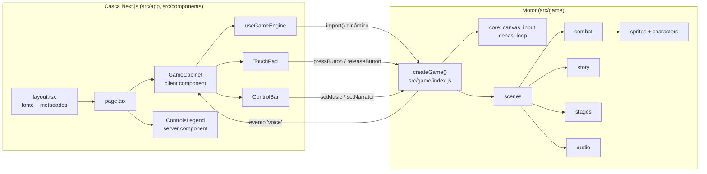

# 01 · Arquitetura

O projeto tem duas camadas bem separadas:

1. **Casca Next.js (React + TypeScript):** a página, os botões, os controles de toque e a legenda. Não sabe nada de luta.
2. **Motor do jogo (JavaScript puro, módulos ES):** tudo que acontece dentro do canvas. Não depende de React e roda também no Node (é assim que os testes funcionam).

As duas conversam por uma API pequena: `createGame()` em [`src/game/index.js`](../../src/game/index.js), com tipos em [`src/game/index.d.ts`](../../src/game/index.d.ts).



## Pastas

```
brainrot-battaglia/
├── src/
│   ├── app/                      # App Router do Next
│   │   ├── layout.tsx            # <html lang="pt-BR">, metadados, viewport, fonte
│   │   ├── page.tsx              # página única: o gabinete do arcade
│   │   ├── fonts.ts              # Press Start 2P via next/font (self-hosted)
│   │   ├── globals.css           # tokens de cor e estilos base
│   │   └── icon.png, apple-icon.png, opengraph-image.png
│   ├── components/game/          # casca React do jogo
│   │   ├── GameCabinet.tsx       # monta o canvas, guarda os toggles, fala com o motor
│   │   ├── useGameEngine.ts      # carrega o motor no cliente e cuida do ciclo de vida
│   │   ├── ControlBar.tsx        # MÚSICA, NARRADOR, CRT, TOQUE, TELA CHEIA
│   │   ├── TouchPad.tsx          # D-pad e botões de ação com pointer capture
│   │   ├── ControlsLegend.tsx    # cartões com os controles (server component)
│   │   └── *.module.css          # CSS Modules de cada componente
│   └── game/                     # motor do jogo (JS puro, sem React)
│       ├── index.js / index.d.ts # API pública: createGame()
│       ├── config.js             # W=320, H=180, WORLD=480, FLOOR=164, fonte
│       ├── state.js              # SET (ajustes), S (campanha), DEBUG
│       ├── events.js             # barramento de eventos motor → página
│       ├── core/                 # canvas, cor, matemática, entrada, cenas + loop
│       ├── audio/                # sintetizador, músicas, narrador, locutor
│       ├── sprites/              # primitivas, atlas HD, cache e hitboxes
│       ├── characters/           # elenco, um arquivo por lutador, carros
│       ├── combat/               # Fighter, Fight, IA, especiais, Treino, Bônus
│       ├── story/                # textos da história e montagem dos painéis
│       ├── stages/               # kit de pintura + um arquivo por cenário
│       ├── world/                # mapa de Brainrotália
│       ├── fx/                   # partículas e popups
│       ├── ui/                   # logo e widgets
│       ├── progression/          # XP e níveis
│       ├── scenes/               # todas as telas e o fluxo da história
│       └── data/atlas-frames.js  # gerado: molduras dos atlas
├── public/atlases/               # um PNG por personagem (servido pelo Next)
├── assets/
│   ├── sprite-sheets/            # arte original 4×3 (fonte do pipeline)
│   └── readme/                   # imagens do README, geradas pelo próprio motor
├── tools/
│   ├── process_sprites.py        # sprite sheet → atlas + atlas-frames.js
│   └── render-readme-art.js      # renderiza as imagens do README
├── tests/                        # testes headless em Node com canvas real
├── docs/                         # esta documentação
└── legacy/                       # versão original em arquivo único (referência)
```

## Mapa de dependências do motor

As setas indicam "importa de". As cenas ficam no topo e o `core` na base.

| Camada | Pastas | Pode importar |
|--------|--------|---------------|
| Entrada | `index.js` | tudo |
| Telas | `scenes/` | todas as camadas abaixo (e outras cenas) |
| Jogo | `combat/`, `story/`, `world/`, `progression/` | conteúdo, render, base |
| Conteúdo | `characters/`, `stages/` | render, base |
| Render e som | `sprites/`, `fx/`, `ui/`, `audio/` | base |
| Base | `core/`, `config.js`, `state.js`, `events.js`, `data/` | só a base |

Ciclos de importação entre cenas existem (por exemplo `title → select → … → title`) e são seguros: as referências só são usadas dentro de funções, nunca durante o carregamento do módulo.

## Por que o motor é JavaScript e não TypeScript?

O motor veio de um arquivo único de 2.300 linhas, muito denso. A migração foi feita **sem reescrever a lógica**: cada módulo é um recorte do código original, e as importações foram calculadas automaticamente. Isso permitiu provar que o jogo continua idêntico (veja [06-ferramentas-e-testes.md](06-ferramentas-e-testes.md#regressão-contra-a-versão-original)). A casca React é TypeScript estrito, e a fronteira entre as duas camadas tem tipos (`index.d.ts`). Tipar o motor aos poucos é um item do [roadmap](08-roadmap.md).

## Ciclo de vida no React

`useGameEngine` carrega o motor com `import('@/game')` dentro de um `useEffect`, então ele nunca roda no servidor (o motor usa `window`, `document` e Web Audio). O motor é um **singleton**:

- O primeiro `createGame()` inicializa tudo uma vez (fonte, atlas, XP, vozes, logo e os 13 cenários).
- `destroy()` para o loop e remove os listeners, mas **mantém o estado** da partida.
- Um novo `createGame()` (por exemplo, no duplo efeito do `StrictMode` em desenvolvimento) só religa o canvas e o loop. A partida continua de onde estava.

## Persistência

| Chave do `localStorage` | Conteúdo |
|-------------------------|----------|
| `brf_xp_v1` | `{ idDoPersonagem: xpTotal }` |
| `brb_voice` | `{ ann, pt, it }`, os nomes das vozes escolhidas |

Todas as leituras e escritas ficam dentro de `try/catch`: com o armazenamento bloqueado (janela anônima, por exemplo), o jogo funciona normalmente, só não salva.
